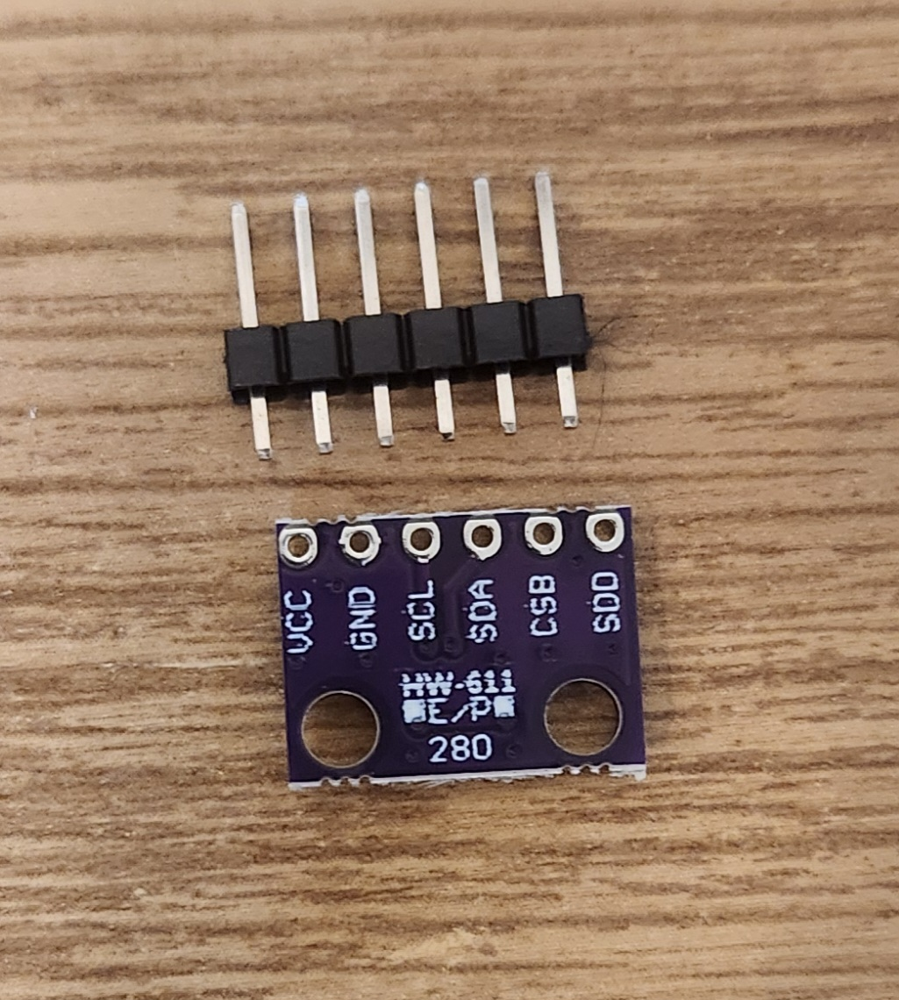
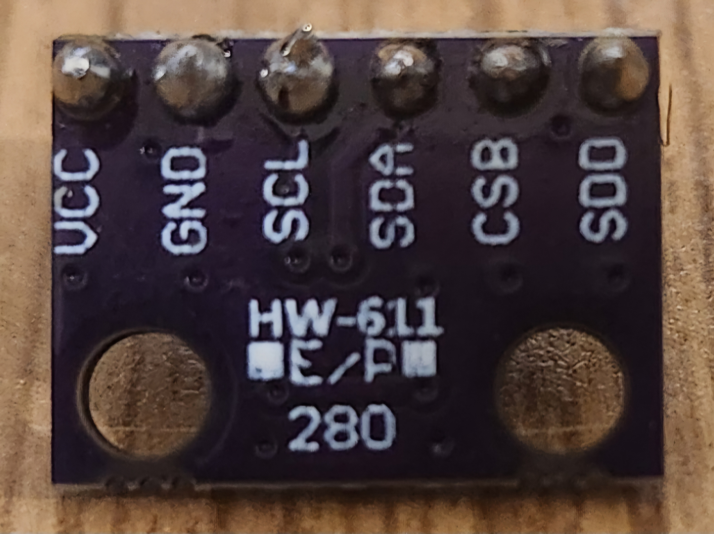
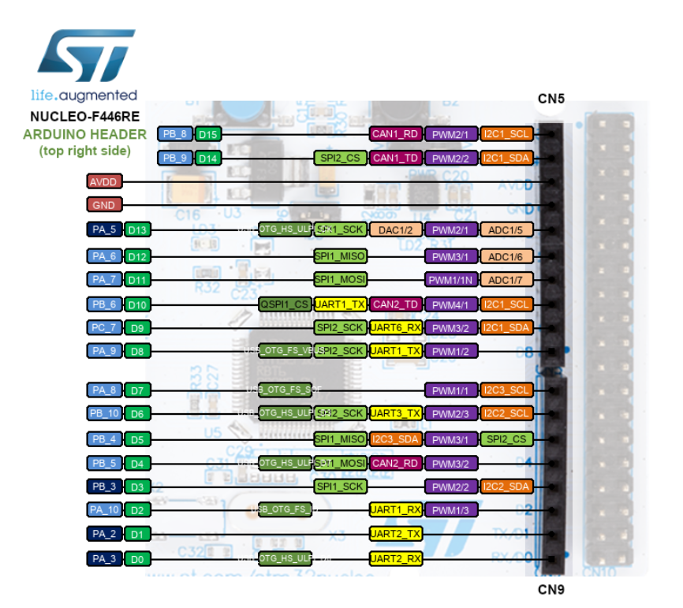
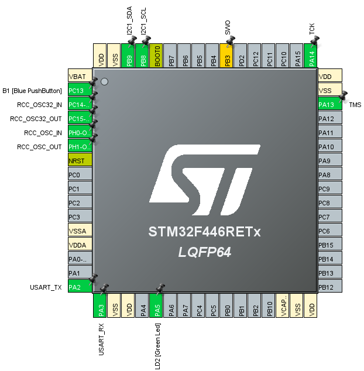
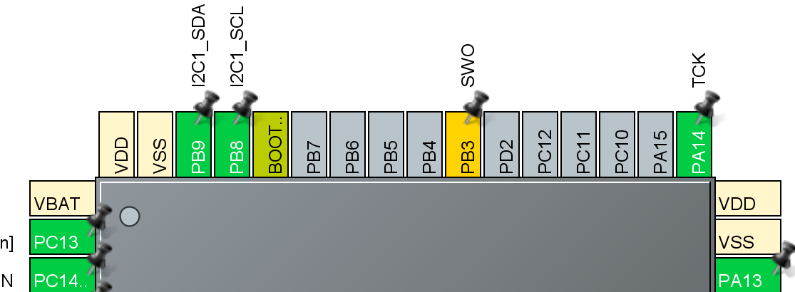
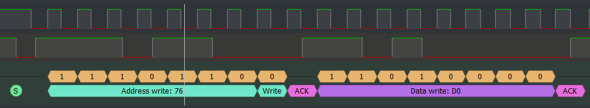

# Embedded C on STM32-Nucleo-F446RE

This is a personal project that documents my first non-academic foray into embedded C programming. This project uses the following software and technologies to read temperature, pressure, and accelerometer data and display them on an LCD:

## Software
- STM32CubeIDE
- STM32CubeMX
- PuTTY
- PulseView

## Hardware
- STM32 Nucleo-F446RE Development Board
- MPU-6050 3-Axis Accelerometer Gyroscope Module
- HiLetGo USB Logic Analyzer
- HiLetgo 6 Pin SPI Micro SD TF Card Adapter Reader Module
- Nucleo LCD-1602
- HiLetgo BMP280 High Precision Atmospheric Pressure Sensor

## Step 1 - Soldering
After a quick "Hello World!"-esque test program that made an on-board LED blink on and off with a delay, I needed to set up one of the sensors that I planned to use for this project.

I decided to start with the BMP280, as it had the fewest pins and therefore seemed the simplest.

As you can see in the image below, the sensor was shipped without its header pins soldered to the board.

<p align="center">

 </p>

This would be my first attempt at soldering electronics, so after a quick YouTube tutorial, I did the best I could and now have a functioning BMP280.

<p align="center">

</p>

## Step 2 - Configuring Peripherals
Next, I had to configure the Nucleo board using STM32CubeMX. This software is a graphical tool that helps to initialize peripherals for the STM32 microcontroller.

Using this interface, you can select different pins and configure their functionality by selecting peripherals.

When a project is initialized using a Nucleo board, CubeMX provides a board-specific starting configuration, including relevant clock and peripheral settings. These settings can still be modified manually. To start out, I'm using the default configuration.

Now that CubeMX has configured the initialization code for me, I need to configure some pins that I'll be using for I2C. To do this, I set PB9 and PB8 to SDA and SCL respectively.

<br>

### Here are some screenshots to show the setup so far:
<div align="center">
To find which pins in CubeMX correspond to which peripherals you need, this diagram from Mbed's old website was useful:<br>

<br><br>

This is a screenshot from CubeMX that shows the entire chip configured.<br>

<br><br>

I configured PB8 and PB9 for I2C1, using PB8 as SCL and PB9 as SDA.<br>

<br><br>
</div>

## Step 3 - Writing Code
Now that the pins are configured, I generate code from CubeMX. This updates all of the code in the project files that are necessary to set up my Nucleo board.

While there are many files that are generated in a project, the main application code is written in `Core/Src/main.c`. In an effort to organize the code, I am writing most of my drivers for different sensors in different files. For example, I have `bmp280.c` in `Core/Src/bmp280.c` and the corresponding header file in `Core/Inc/bmp280.h`.

Throughout `main.c` there are comments that show where the user can inject code. It is important to adhere to these comments, because if the pin configurations need to be changed to add or alter functionality, the project code has to be regenerated. Code placed outside these designated user-code sections may be overwritten when the project is regenerated.

For example, these are where you include libraries you need for your program:
```
/* USER CODE BEGIN Includes */
#include <string.h>
#include <stdio.h>
#include "bmp280.h"
/* USER CODE END Includes */
```

This section runs before the infinite loop, so sensor initialization can be placed here:
```
/* USER CODE BEGIN 2 */
bmp280_init(&hi2c1);
/* USER CODE END 2 */
```
This is the infinite loop, so read from sensors and update the display here:
```
/* USER CODE BEGIN WHILE */
while (1)
{
    bmp280_read_registers(&hi2c1, &huart2);
    bmp280_calc_temp_press();
    bmp280_print_temp(&huart2);
/* USER CODE END WHILE */

/* USER CODE BEGIN 3 */
}
/* USER CODE END 3 */
```

Now I'd like to walk through a few of the functions from the code snippets above starting with `bmp280_init(&hi2c1)`. To communicate to the slave devices using I2C, I use the Hardware Abstraction Layer (HAL) which provides functions that abstract the communication to the sensors. Here are two frequently used functions:

<p align="center"><code>HAL_I2C_Mem_Write()</code> and <code>HAL_I2C_Mem_Read()</code></p>

To initialize the BMP280, I have to write to the config register with the address `0xF4`. The [datasheet](https://cdn-shop.adafruit.com/datasheets/BST-BMP280-DS001-11.pdf) details the registers that need to be written to and what values to write based on desired functionality. Section 4.3.4 details the different values of the control register. For now, I will be using the normal mode of the sensor with x1 oversampling for both temperature and pressure.

The config register is an 8 bit register. The 3 most significant bits, 7, 6, and 5 control the oversampling of the temperature sensor. Bits 4, 3, and 2 are for pressure oversampling, and the last two bits, 1 and 0, are for the mode. For x1 oversampling of both temperature and pressure, the top 6 bits of the 8 bit integer I write to the control register must be `001 001`. Section 3.6 tells me that the last two bits need to be `11` to have the sensor operate in the Normal Mode. So I need to write an 8 bit value of `0010 0111` to the control register at the address `0xF4`.

Knowing the register address and the value I want to write to that address only covers 2 of the 7 parameters that `HAL_I2C_Mem_Write()` needs. Here's the full function call:

```
HAL_I2C_Mem_Write(hi2c1, BMP280_ADDR, CONFIG_REG, I2C_MEMADD_SIZE_8BIT, &config, 1, HAL_MAX_DELAY);
```

Now I'd like to go through each parameter one by one. The first parameter is a pointer to a `I2C_HandleTypeDef` structure that contains the configuration information for the specified I2C. This is a `struct` that was generated by CubeMX when I configured the I2C1 peripherals. The name of the `struct` is `hi2c1`, so I pass that to my initialization function.

Next is the address of the device. Section 5.2 of the datasheet goes over the I2C interface and explains the address. The address changes depending on how the pins are connected. If the Serial Data Output (SDO) pin is grounded, the slave address is `0x76`. If SDO is connected to VDDIOI then the address is `0x77`. I decided to ground the SDO pin, so my address is `0x76`. The datasheet goes on to explain that to write and read with I2C, the address becomes `1110 11X0` (where X is 'don't care', meaning in this case it depends on the state of the SDO pin). So for me, the address is `1110 1100`. The least significant bit changes depending if the protocol is reading or writing, so I just shift the address 1 bit to the left to prepare it for the HAL:

<p align="center"><code>static const uint8_t BMP280_ADDR = 0x76 << 1;</code></p>

The third parameter is the address of the register I'm writing to, which in this case is the config register which I already went over.

The fourth is the size of the internal memory address, which in this case is 8 bits for the 8 bit control register.

Then for the 5th, I pass a pointer to the data I'm writing to the register, which I define as `uint8_t config = 0x27` at the top of the file.

6th is the amount of data to be sent in bytes, so just `1`

Lastly is the timeout, which specifies how long to continue trying to send data.

So the entire initialize function is just that one function call to write to the control register:

```
static const uint8_t BMP280_ADDR = 0x76 << 1;
static const uint8_t CONFIG_REG  = 0xF4;
uint8_t config                   = 0x27;

void bmp280_init(I2C_HandleTypeDef *hi2c1)
{
    HAL_I2C_Mem_Write(hi2c1, BMP280_ADDR, CONFIG_REG, I2C_MEMADD_SIZE_8BIT, &config, 1, HAL_MAX_DELAY);
}
```


## Step 4 - Inspecting the I2C Protocol
Now that I have the program running, I wanted to learn to use PulseView to view signals.

PulseView is a very neat program. You can view signals that the microcontroller, the master device in this instance, is sending and receiving to and from the slave devices, which is just the BMP280 for now.

This image shows a complete exchange between the microcontroller and sensor.


## References
*"If I have seen further it is by standing on the shoulders of Giants."* - Isaac Newton

This [YouTube tutorial by Shawn Hymel for the DigiKey YouTube channel](https://www.youtube.com/watch?v=hyZS2p1tW-g&list=PLEBQazB0HUyRYuzfi4clXsKUSgorErmBv) was essential for my introduction to the STM32 development environment.

[ST's user manual](https://www.st.com/resource/en/user_manual/um1724-stm32-nucleo32-boards-mb1180-stmicroelectronics.pdf) shows what pins are compatible with what peripherals. This website was helpful to relate things like PB_8 to I2C1_SCL and PB_9 to I2C1_SDA, which told me where to look in CubeMX for the signals I needed.

This is the [datasheet from Bosch for the BMP280](https://cdn-shop.adafruit.com/datasheets/BST-BMP280-DS001-11.pdf). It contains the information needed to access the temperature and pressure data from the sensor's registers. 

I found this [paper written by Joseph Wu for Texas Instruments](https://www.ti.com/lit/an/sbaa565/sbaa565.pdf?ts=1791207882130&ref_url=https%253A%252F%252Fwww.google.com%252F) that details how the I2C protocol works. It was topical when I was inspecting signals on the logic analyzer.

Here is the [Hitachi HD44780 datasheet](https://cdn-shop.adafruit.com/datasheets/HD44780.pdf) that I used.